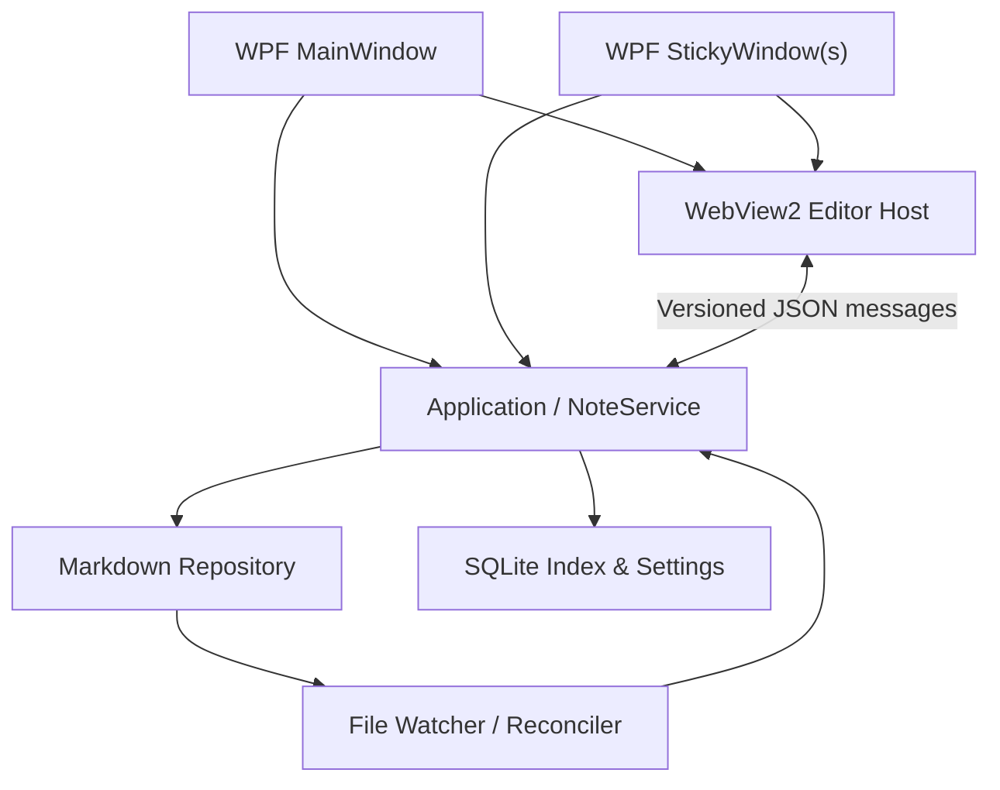

# Hunmin Notes — 상세 설계서 v0.1

> 상태: 검토·승인용 초안 · 작성일: 2026-11-01 · 대상: Windows 10/11

## 1. 개요

훈민메모패드의 빠른 데스크톱 포스트잇 사용 경험을 참고하되, 중앙 관리 창과 다중 독립 포스트잇 창을 결합한 Markdown 기반 메모 앱을 새로 만든다. 기존 바이너리를 제품에 포함하거나 기존 코드를 복사하지 않는다. REA(Reverse Engineer Anything)는 허가된 원본을 관찰·분석하여 동작 명세와 테스트 사례를 작성하는 조사 도구로 사용한다.

### 1.1 확정된 결정

| 구분 | 결정 |
|---|---|
| 플랫폼 | Windows 10/11 우선 |
| 데스크톱 기술 | C# / .NET / WPF |
| 웹 편집 UI | WebView2 + TypeScript |
| 사용 형태 | 중앙 관리 창 + 독립 포스트잇 창 다중 실행 |
| 편집 | WYSIWYG 및 Markdown 소스 모드 전환 |
| 본문 원본 | 개별 `.md` 파일 |
| 관리 데이터 | SQLite(검색 인덱스, 창 상태, 캐시 등) |
| 저장 특성 | 로컬 우선, 자동 저장, 외부 편집 허용 |

### 1.2 목표 / 비목표

**목표**: 1초 이내에 체감되는 빠른 메모 진입(성능 목표, 검증 필요), 다중 포스트잇, 완전한 Markdown 원문 접근성, 안정적인 자동 저장과 복구, 강력한 검색, Windows 트레이 경험.

**초기 비목표**: 계정 서버, 협업 편집, 모바일 앱, 클라우드 동기화 서비스 자체 개발, 기존 훈민메모패드 파일 형식의 무조건적 완전 호환, OCR/AI 기능.

## 2. 후보 접근 방식과 선정 근거

| 접근 | 장점 | 한계 | 판단 |
|---|---|---|---|
| WPF + WebView2 | Windows 창/트레이/단축키 제어, 웹 편집기 생태계 활용 | 두 UI 런타임 간 브리지 필요 | **선정** |
| Tauri + React | 향후 멀티플랫폼 가능성 | Windows 고유 창 UX를 별도로 세밀하게 구현 | 이번 프로젝트에서는 제외 |
| 순수 WPF 편집기 | 단일 기술 스택 | 현대적 Markdown WYSIWYG 확장 비용 | 이번 프로젝트에서는 제외 |

WYSIWYG 후보는 TipTap/ProseMirror 기반과 Milkdown을 기술 검증(spike)으로 비교한다. 후보 확정 조건은 마크다운 왕복 보존, 표·체크리스트·코드 블록, IME/한글 입력, 붙여넣기/Undo 안정성이다. 특정 라이브러리의 완전한 Markdown 무손실 지원을 미리 가정하지 않는다.

## 3. 사용자 경험과 화면 명세

### 3.1 중앙 관리 창

**레이아웃:** 왼쪽 내비게이션(전체/최근/즐겨찾기/폴더/태그/휴지통), 중앙 목록(제목·요약·수정 시각·상태), 오른쪽 편집기(도구막대, WYSIWYG/소스 전환, 필요 시 미리보기). 창 크기에 따라 목록/편집 분할 비율을 조정한다.

**주요 동작:** 메모 생성, 복제, 삭제·복원, 제목 변경, 폴더 이동, 태그 편집, 전체 검색, 제목·본문 검색, 정렬, 즐겨찾기, 포스트잇으로 열기/닫기, 경로 열기, Markdown 가져오기/내보내기, 인쇄(후순위).

### 3.2 독립 포스트잇 창

각 포스트잇은 동일한 Note ID를 가리키는 별도 WPF 창이다. 메모 하나를 여러 개 창에 띄우는 동작은 **초기에는 한 메모당 하나의 포스트잇 창**으로 제한해 충돌 가능성을 줄인다.

- 제목/본문, 바탕색 테마, 크기/위치, 투명도, 항상 위, 잠금(실수 편집 방지)
- 우클릭 메뉴: 새 메모, 포스트잇 고정, 중앙 관리에서 열기, 복제, 휴지통, 색상/투명도
- 더블클릭 또는 단축 버튼으로 WYSIWYG 편집; 소스 모드는 확장 메뉴에서 전환
- 다중 모니터별 위치와 Windows DPI 변경 대응, 화면 밖 창 위치 복구
- 시스템 트레이: 모든 메모 표시/숨기기, 빠른 생성, 중앙 관리 열기, 설정, 종료
- 메모 닫기와 삭제는 별개: 닫기는 창 상태만 변경, 삭제는 휴지통 이동

### 3.3 편집 원칙

Markdown 문서를 원본으로 취급한다. 편집기 내부 모델은 렌더링 뷰이며, 파일의 원문을 무조건 재직렬화하지 않는다. WYSIWYG가 지원하지 않는 구문이 있을 경우 원문 손실 위험을 사용자에게 알려 소스 모드로 전환하거나 읽기 전용으로 표시한다. YAML frontmatter는 일반 본문 편집에서 숨기고 전용 메타데이터 UI로 관리한다.

**초기 지원 구문:** 제목, 단락, 굵게/기울임, 링크, 인라인 코드, fenced code block(언어 표기), 인용, 순서/비순서 목록, 체크리스트, 표, 구분선, 로컬 이미지. HTML 임의 실행 및 원격 스크립트는 차단한다.

## 4. 저장소와 파일 규격

### 4.1 권장 디렉터리

```text
HunminNotes/
  notes/
    Inbox/
      2026-11-01-meeting.md
    Projects/
      architecture.md
  assets/
    <note-id>/
      image-001.png
  .hunmin/
    hunmin.db
    settings.json
    backups/
```

루트는 사용자 지정 가능하게 하되, 기본은 사용자 문서 영역 아래 전용 폴더로 제안한다. `.hunmin`은 앱 전용 메타데이터이므로 앱에서 관리한다. 동기화 폴더 사용 시 DB 파일은 별도 로컬 캐시로 옮길 수 있도록 데이터 경로 분리를 지원하는 것이 바람직하다.

### 4.2 Markdown 예시

```markdown
---
id: 018f5df0-7e6c-7ad0-a8c1-9b67490da11b
title: 장애 대응 체크리스트
created: 2026-11-01T09:30:00+09:00
updated: 2026-11-01T09:45:00+09:00
tags: [operations, checklist]
---

# 장애 대응 체크리스트

- [ ] 서비스 상태 확인
- [ ] 로그 분석

```sql
SELECT * FROM system_events LIMIT 10;
```
```

ID는 생성 시 부여하는 불변 키다. 같은 ID를 가진 외부 복제본 발견 시 자동 덮어쓰기하지 않고 중복 해결을 요구한다. 파일 경로 변경은 메모 삭제로 처리하지 않는다. 제목과 태그는 Frontmatter를 이식 가능한 정본으로 간주하며 SQLite는 이를 파생 인덱스로 보관한다.

### 4.3 SQLite 제안 스키마

```sql
CREATE TABLE notes (
  id TEXT PRIMARY KEY,
  relative_path TEXT NOT NULL UNIQUE,
  title TEXT NOT NULL,
  content_hash TEXT NOT NULL,
  modified_utc TEXT NOT NULL,
  indexed_utc TEXT NOT NULL,
  is_favorite INTEGER NOT NULL DEFAULT 0,
  is_deleted INTEGER NOT NULL DEFAULT 0
);
CREATE TABLE note_tags (
  note_id TEXT NOT NULL,
  tag TEXT NOT NULL,
  PRIMARY KEY (note_id, tag)
);
CREATE TABLE note_windows (
  note_id TEXT PRIMARY KEY,
  is_open INTEGER NOT NULL DEFAULT 0,
  x REAL, y REAL, width REAL, height REAL,
  monitor_id TEXT, dpi_scale REAL,
  is_topmost INTEGER NOT NULL DEFAULT 0,
  opacity REAL NOT NULL DEFAULT 1.0,
  color_token TEXT NOT NULL DEFAULT 'yellow',
  is_locked INTEGER NOT NULL DEFAULT 0
);
CREATE VIRTUAL TABLE notes_fts USING fts5(
  note_id UNINDEXED, title, body, tags, tokenize='unicode61'
);
```

FTS5 한글 검색은 기본 토크나이저의 형태소·부분 문자열 검색 품질을 별도로 검증한다. 필요하면 trigram 또는 별도 한글 검색 인덱스를 도입한다. 즐겨찾기와 휴지통 같은 앱 상태는 SQLite에 있으므로 DB 재구성만으로 100% 복원되지 않는다. 추후 백업 정책에 포함한다.

### 4.4 저장·감시·충돌 정책

1. 편집 변경을 Debounce(초안 300~800ms) 후 원자적 저장(동일 볼륨 임시 파일 작성 → flush → replace)한다.
2. 최종 저장 직전 디스크 파일 해시/수정 시각이 편집 시작 당시 기준과 달라졌는지 확인한다.
3. 외부 변경이 있고 내부 미저장 편집이 없으면 재로드한다. 내부 변경이 남았다면 자동 덮어쓰지 않고 비교/선택 UI 및 충돌 복사본을 제공한다.
4. FileSystemWatcher 이벤트는 중복·누락 가능성이 있으므로 주기적인 디렉터리 재스캔과 해시 검증으로 보완한다.
5. 파일 저장 성공 후 인덱스를 갱신한다. 실패 시 에디터 내용을 보존하고 오류/재시도 상태를 표시한다.
6. 충돌 없는 동일 앱 내 다중 창 수정은 NoteService의 메모별 직렬화 큐를 통해 처리한다.
7. 종료/크래시 복구를 위해 임시 편집 저널을 앱 영역에 보관하고, 다음 실행 때 복원 여부를 묻는다.

## 5. 구성 요소와 경계



### 5.1 프로젝트/모듈 제안

| 모듈 | 책임 |
|---|---|
| `HunminNotes.App` | WPF 호스트, 메인·포스트잇 창, 트레이, 단축키 |
| `HunminNotes.Core` | Note 도메인, 명령, 저장 상태, 충돌 정책 |
| `HunminNotes.Storage` | Markdown/Frontmatter, 자산, SQLite, FTS, 감시 |
| `HunminNotes.EditorHost` | WebView2 초기화, 브리지, CSP/보안 |
| `editor-web` | TypeScript 기반 WYSIWYG·소스 편집기 |
| `HunminNotes.Tests` | 단위/통합/회귀 및 계약 테스트 |

### 5.2 WPF ↔ WebView2 브리지

메시지는 `protocolVersion`, `requestId`, `noteId`, `revision`, `type`, `payload`를 가진 JSON 계약으로 제한한다. 예: `editor.ready`, `note.load`, `note.changed`, `note.saveRequested`, `note.saved`, `note.conflict`, `editor.modeChanged`. 브리지에서는 메시지 타입, 크기, 출처, URL, 파일 경로를 검증한다. 웹 페이지가 OS 파일에 직접 쓰지 않고, WPF의 저장 서비스만 파일 쓰기를 수행한다.

## 6. REA 원본 분석 계획

**입력:** 합법적으로 보유·분석 가능한 훈민메모패드 설치본 또는 실행 파일, 원본 실행 환경(가능하면 격리된 Windows VM), 테스트용 비실제 데이터.

**분석 순서:**

1. 버전, 파일 해시, EXE/DLL 목록, 파일 종류·서명, 프로세스/창 구조 확인
2. 메뉴·단축키·트레이·다중 메모 UI를 영상/스크린샷과 함께 행위 관찰
3. 파일/레지스트리 쓰기, 종료/재시작, 오작동/경계 조건 검증
4. 창 생성·이동·DPI·항상 위·포커스·트레이 동작 시나리오 정의
5. 원본 데이터 포맷은 마이그레이션 필요성이 확인된 범위에서만 분석
6. 분석 결과를 증거 ID, 재현 단계, 관찰 사실, 추정, 신뢰도, 대상 테스트로 정리

REA가 자동으로 모든 동작을 재구성하거나 실행 가능 코드를 생성한다고 가정하지 않는다. REA의 결과는 사람이 재현하여 검증한다. 악성코드 유사 분석·패치·라이선스 우회가 목적이 아니며, 원본 권리 및 라이선스 제한을 검토한다.

### 6.1 REA 작업 지시 프롬프트(초안)

```text
허가된 훈민메모패드 실행 파일을 대상으로, 신규 메모 앱 개발을 위한 행동 명세를 조사하라.
대상은 창/트레이/메뉴/단축키/저장·복구/자동 저장/다중 모니터 동작이다.
먼저 정적 식별과 실행 환경을 기록하고, 각각의 기능을 재현 가능한 입력-동작-결과로 기술하라.
관찰 사실과 추론을 반드시 구분하고, 증거(스크린샷, 로그, 호출 흔적, 파일 diff)와 신뢰도를 남겨라.
원본 코드 복제, 실행 파일 수정, 라이선스 우회는 수행하지 말라.
결과물: INVENTORY.md, BEHAVIOR_MATRIX.md, STORAGE_FINDINGS.md,
WINDOW_SCENARIOS.md, EVIDENCE_INDEX.md, OPEN_QUESTIONS.md.
```

## 7. 기능 우선순위

| 단계 | 범위 | 완료 기준 |
|---|---|---|
| P0 기술 검증 | WPF/WebView2 브리지, 편집기 왕복 변환, 한글 IME, 다중 창 | 검증 문서와 실패 사례 확보 |
| MVP 1 | 메모 CRUD, `.md` 저장, 자동 저장, 중앙 목록, 포스트잇 다중 창, 트레이 | 재시작 후 본문/창 복구 |
| MVP 2 | 소스/WYSIWYG 전환, 체크리스트/표/코드, 검색, 태그/폴더 | 기본 Markdown round-trip 테스트 통과 |
| V1 | 파일 감시/충돌 UI, 즐겨찾기, 휴지통, 자산 이미지, 백업, 설정 | 외부 수정·크래시·다중 모니터 테스트 통과 |
| 후속 | 가져오기 도구, 단축키 사용자 설정, 프린트, 동기화 가이드, 플러그인 | 별도 우선순위 결정 |

## 8. 주요 품질 및 검증 기준

- **원문 보존:** WYSIWYG를 열고 아무 변경 없이 닫거나 모드 전환만 할 때 원본 파일 바이트가 바뀌지 않아야 한다.
- **편집 왕복:** 지원 Markdown 기능의 파싱·렌더링·수정·직렬화 후 의미와 사용자 구성이 유지되어야 한다. 지원하지 않는 확장 구문을 조용히 삭제하지 않는다.
- **한글 입력:** 초성/중성 조합, 커서 이동, 선택 범위, Undo/Redo, 긴 문단, 붙여넣기 테스트.
- **데이터 안정성:** 전원 차단 모의, 강제 종료, 저장 실패, 디스크 부족, 파일 잠금, 중복 ID, 경로 변경, 외부 수정 테스트.
- **다중 모니터:** DPI 혼합, 해상도 변경, 모니터 분리, 작업 표시줄 위치 변경 후 접근 가능한 창 복구.
- **검색:** 1만 개 이상의 샘플 노트를 대상으로 초기 인덱싱 시간, 검색 지연, 한글 검색 정확도 계측. 성능 수치는 spike 후 목표 확정.
- **보안:** Markdown 내 HTML/script, `file:`/외부 URL, 이미지 경로 순회, 원격 이미지 추적, WebView2 브리지 오용 차단.
- **배포:** 런타임/WebView2 배포 정책, 서명, 업데이트/롤백, 사용자 데이터 유지 테스트.

## 9. 백업과 복구

Markdown과 `assets/`는 개별 파일로 백업 가능하다. SQLite에는 창 배치/즐겨찾기/휴지통 등 앱 고유 상태가 있으므로 **일관성 있는 SQLite 백업**을 별도로 수행한다. DB의 검색 인덱스는 재생성 가능해야 한다. 파일별 임시 저장본은 장기 백업이 아니므로 백업 보존 기간과 버전 스냅샷 정책을 설정 화면에서 제공한다.

## 10. 리스크와 의사 결정 기록

| 리스크 | 영향 | 완화책 |
|---|---|---|
| WYSIWYG Markdown round-trip 손실 | 데이터 변형 | 기술 검증 우선, 원문 보존, 미지원 구문 경고 |
| 파일 감시 이벤트 누락/중복 | 오래된 화면/충돌 | 재스캔·해시·revision 조정 |
| HTML/URL 콘텐츠 | 악성 스크립트·정보 유출 | 제한된 렌더러, CSP, URL/리소스 정책 |
| SQLite 손상 | 창 배치·관리 상태 손실 | 백업 및 인덱스 재생성 |
| 다중 창 메모리 비용 | 느린 시작 | 필요 시 WebView2 환경 공유와 지연 로딩 |
| 원본 역공학 결과 불확실 | 잘못된 재현 | 재현 가능한 관찰·증거 기반 명세 |

### 결정 기록

- ADR-001: 하이브리드 UI — 중앙 관리 창 + 독립 포스트잇 창
- ADR-002: WYSIWYG + Markdown 소스 모드
- ADR-003: Markdown 파일이 본문 정본, SQLite는 인덱스/관리 정보
- ADR-004: Windows 앱은 C# WPF + WebView2
- ADR-005(제안): 편집기 후보를 round-trip/한글 IME spike로 선정

## 11. 구현 이전 승인 항목

1. MVP에서 사용할 Markdown 구문의 정확한 범위 및 확장 구문 정책
2. 파일 경로/백업/휴지통/충돌 복구 UX
3. WYSIWYG 엔진 선정 결과 및 성능 기준
4. 훈민메모패드 원본 파일/테스트 실행 환경 확보 여부
5. 제품명, 배포 방식 및 향후 macOS 계획

**다음 단계:** 본 설계서 승인 → 구현 계획(작업 단위·테스트·마일스톤) 작성 → P0 기술 검증 → MVP 개발.
