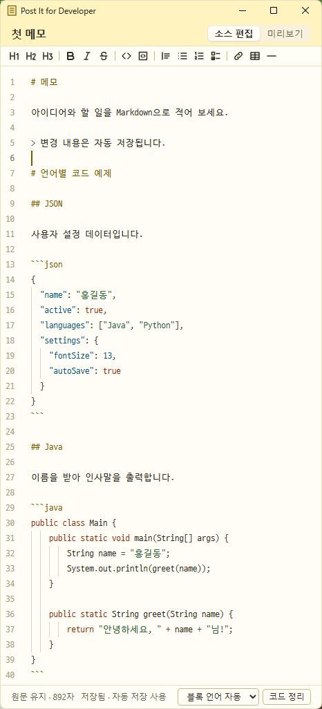
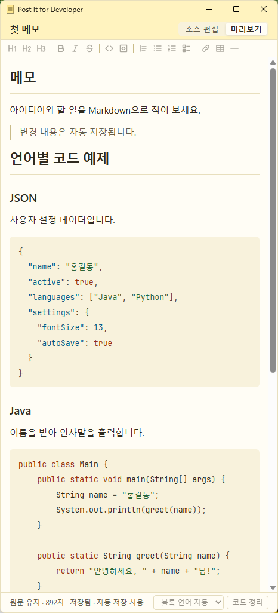

# Post It for Developer (DevPostIt)

개발자를 위한 Windows용 Markdown 포스트잇 메모앱입니다. 훈민정음의 부속물인 훈민메모패드의 사용성을 제공하면서 개발자를 위한 Markdown 지원 그리고 Snagit의 Object Capture 기능으로 바로 캡춰하고 파일로 저장하고, MD 파일에 링크까지 걸어주는 메모앱입니다. WPF와 WebView2로 만들었고, 메모를 개별 Markdown 파일로 저장하며 Monaco 편집기를 사용합니다.

<p align="center">
  
  
</p>

## 기능

**메모와 창**

- 여러 메모를 각각의 창으로 사용
- 24px 아이콘으로 접기 (제목 표시줄 더블클릭 또는 최소화), 클릭으로 복원, 드래그로 이동
- 메모별 항상 위와 색상 6가지
- 창 위치·크기, 접힌 아이콘 위치, 열어 둔 메모 복원
- 트레이 메뉴: 새 메모, 화면 캡처, 소스코드 포맷터, 마인드맵, 할 일, 달력, Markdown 가져오기, 검색, 메모 목록, 휴지통, 설정, 도움말, 정보, 모두 표시/접기, 종료
- 트레이로만 시작 옵션

**편집**

- Monaco 소스 편집과 미리보기
- 서식 아이콘 툴바와 단축키: 제목, 굵게, 기울임, 취소선, 코드, 인용, 목록, 할 일, 링크, 표, 구분선
- 찾기·바꾸기, 줄 이동, 명령 팔레트, 여러 커서, 줄 옮기기·복제, 주석, 구역 접기, 자동 완성
- 현재 줄 강조, 줄 번호, 자동 줄바꿈, 미니맵, 공백 문자, 괄호 색, 구역 제목 고정
- 미리보기의 체크박스 클릭과 코드 복사
- 미리보기의 웹·메일 링크를 확인 후 기본 앱으로 열기

**코드**

- Monaco가 지원하는 모든 언어와 JSON의 코드 블록 하이라이트 (소스 편집, 미리보기)
- 코드 정리: JSON, JSON5, YAML, XML, Java, JavaScript, JSX, Flow, TypeScript, TSX, HTML, Vue, Angular, Handlebars, CSS, SCSS, Less, GraphQL, Markdown, MDX, C, C++, C#, Objective-C, Protobuf, Python, Go, PHP, Shell, SQL, MySQL, PostgreSQL, Redshift
- Rust, Scala, Ruby, R 등 정리 도구가 없는 언어는 색 구분만 지원
- 소스코드 포맷터: 메모와 별개인 Monaco 창에서 언어와 들여쓰기 간격(기본 4)을 골라 소스 전체 포맷 (저장하지 않음)

**붙여넣기**

- Excel, Google Sheets에서 복사한 셀을 Markdown 표로 변환
- 스크린샷과 복사한 이미지 파일을 메모에 저장하고 미리보기와 PDF에 표시
- 미리보기 버튼 오른쪽의 폴더 아이콘으로 메모의 이미지 폴더 열기
- 미리보기에서 이미지 크기 조절 (25%, 50%, 75%, 원래 크기)
- 쓰지 않는 이미지를 찾아 확인 후 Windows 휴지통으로 정리

**다이어그램**

- Mermaid 코드 블록을 미리보기와 PDF에 그림으로 표시
- draw.io 다이어그램 추가와 편집 ([draw.io Desktop 설치](#drawio-desktop-설치) 필요)

**마인드맵**

- 여러 마인드맵 저장, 자동 저장, 복제, 삭제
- Tab, Enter, 방향키, F2, Delete, Space로 키보드만으로 작업
- 끌어서 주제 옮기기, 화면 이동, 휠 확대·축소, 양쪽·한쪽 배치
- 접기·펼치기, 색, 굵게, 표시, 메모, 링크, 찾기, 실행 취소
- 가지 복사·잘라내기·붙여넣기·복제, 들여쓴 글 붙여넣기, Markdown 복사, PNG 저장

**할 일**

- Enter로 바로 등록하고 입력칸에 커서 유지
- 오늘 할 일, 중요, 계획된 일정, 사용자 목록, 검색, 정렬, 끌어서 순서 변경
- 단계, 기한, 알림, 반복, 메모

**달력**

- 월간, 주간, 일간, 목록 보기
- 일정 추가·편집·끌어서 이동·시간 조절, 종일, 반복, 알림, 색
- 한국 공휴일과 대체공휴일 표시, 기한이 있는 할 일 표시

**화면 캡처**

- 커서 아래 UI 요소를 강조하고 클릭해 캡처 (휠로 상위·하위 요소 선택)
- 드래그 영역 캡처, 캡처 전 대기
- 메모의 버튼과 Ctrl+Shift+C, 트레이, 전역 단축키 Ctrl+Shift+PrintScreen
- 캡처 후 화살표, 사각형, 글자, 모자이크 주석
- 캡처한 그림을 최근 메모의 커서 위치에 삽입

**검색과 내보내기**

- 전체 메모 검색 (제목, 본문, 태그)
- PDF로 저장

**가져오기**

- 외부 Markdown 파일을 새 메모로 복사 (UTF-8, 한글 옛 인코딩, 원본 유지)

**데이터 보호**

- Markdown 파일이 원본이며 SQLite 검색 DB는 다시 만들 수 있음
- 500ms 자동 저장과 크래시 복구
- 휴지통에서 복원과 영구 삭제
- 전체 백업과 복원 (복원 전 데이터는 지우지 않음)
- 앱 밖에서 바뀐 파일을 다시 불러오고, 편집 중이면 양쪽 내용을 보존
- 데이터 폴더 변경 (OneDrive 폴더도 선택 가능)

**글꼴과 설정**

- D2 Ligature, JetBrains Mono, Consolas, 설치된 고정폭 글꼴, 합자
- 본문 글꼴 선택
- 전체, 편집기, 미리보기 글자 크기를 각각 설정하고 줄 간격 조절
- 메모에서 Ctrl+=/-/0으로 전체 글자 크기 조절
- 별도 설정 창, 설정은 열린 메모에 바로 적용

**업데이트**

- GitHub 릴리즈에서 새 버전을 확인해 알리고, 트레이에서 고르면 해시와 시험 실행을 확인한 뒤 설치
- 기능 안내는 트레이의 ‘도움말’에서 볼 수 있음

**아직 없는 기능:** 가져오는 Markdown이 참조하는 이미지 복사, 태그·폴더 관리 화면, 설치 패키지, 코드 서명

## 설치

[릴리즈](https://github.com/fharenheit/DevPostIt/releases/latest)에서 exe를 내려받아 실행합니다. 설치 과정은 없고 WebView2 Runtime만 있으면 됩니다. 새 버전은 트레이의 ‘업데이트 설치’로 올립니다.

코드 서명이 없어 SmartScreen 경고가 뜨거나 Smart App Control에 차단될 수 있습니다.

## 주요 단축키

| 키 | 동작 |
| --- | --- |
| Ctrl+Shift+PrintScreen | 화면 캡처 (어디서나) |
| Ctrl+Shift+C | 화면 캡처 (메모에서) |
| Ctrl+Shift+F | 메모 검색 |
| Ctrl+, | 설정 |
| Ctrl+F, Ctrl+H | 찾기, 바꾸기 |
| Ctrl+Alt+F | 코드 블록 정리 |
| Ctrl+=, Ctrl+-, Ctrl+0 | 글자 크기 |

전체 사용법은 트레이의 ‘도움말’에 있습니다.

## 데이터 위치

메모는 `%LOCALAPPDATA%\DevPostIt\Data`에 Markdown 파일로 저장합니다. 설정에서 폴더를 열거나 바꿀 수 있고, ‘백업’으로 zip 파일 하나에 담을 수 있습니다.

## draw.io Desktop 설치

draw.io 다이어그램 편집에 필요합니다. Mermaid는 설치가 필요 없습니다.

```powershell
winget install --id JGraph.Draw --exact
```

또는 [릴리즈 페이지](https://github.com/jgraph/drawio-desktop/releases/latest)에서 내려받습니다. 기본 설치 위치만 찾으므로 다른 폴더에는 설치하지 마세요. 실제 draw.io Desktop과의 연동은 아직 시험하지 못했습니다.

## Windows 로그인 시 자동 실행

Win+R에서 `shell:startup`을 실행하고, 열린 폴더에 exe의 바로 가기를 넣습니다. 창 없이 시작하려면 설정에서 ‘트레이로만 시작’을 켭니다.

## 개발

.NET SDK 10.0.403, Node.js 24.22.1, npm 11.19.1, WebView2 Runtime이 필요합니다.

```powershell
dotnet run --project src/DevPostIt.App
```

테스트 명령과 작업 지침은 [AGENTS.md](AGENTS.md), 현재 상태는 [HANDOFF.md](docs/development/HANDOFF.md)에 있습니다.

## 릴리즈 빌드

```powershell
dotnet publish src/DevPostIt.App -c Release -r win-x64 --self-contained true -p:PublishSingleFile=true -p:IncludeAllContentForSelfExtract=true -p:EnableCompressionInSingleFile=true -o .tools/release/publish
```

버전은 `src/DevPostIt.App/DevPostIt.App.csproj`의 `Version`에 있습니다.
